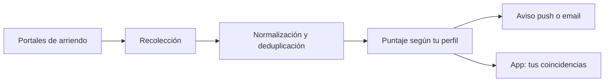

<div align="center">


# depazo

**El departamento que buscas en Quito, en cuanto se publica.**

depazo reúne los arriendos de varios portales, los compara con lo que tú quieres<br>
y te avisa en el teléfono antes de que otro llegue primero.

[Cómo funciona](#cómo-funciona) · [Qué hace](#qué-hace) · [Fuentes](#fuentes-de-anuncios) · [Empezar](#empezar) · [Documentación](#documentación)

</div>

---

## Por qué existe

Buscar departamento en Quito significa revisar cinco sitios varias veces al día, descartar a mano lo que no te sirve y, aun así, enterarte tarde de los buenos. depazo hace ese trabajo por ti: busca sin descanso, entiende tus preferencias y solo te interrumpe cuando aparece algo que de verdad vale la pena.

## Cómo funciona



1. **Recolecta.** Cada portal tiene su propio adaptador. Unos se leen de forma automática y otros desde tu navegador.
2. **Ordena.** Los anuncios se convierten a un mismo formato: precio en USD, alícuota, área, habitaciones, sector y coordenadas. Los repetidos se unen.
3. **Puntúa.** Cada anuncio recibe un puntaje de compatibilidad con tu perfil de búsqueda, con un desglose que explica el porqué.
4. **Avisa.** Si un anuncio nuevo, o uno que bajó de precio, supera tu puntaje mínimo, llega una notificación a tus dispositivos.

## Qué hace

| | |
|---|---|
| **Búsqueda continua** | Revisa los portales por ti durante todo el día, con una frecuencia baja y respetuosa. |
| **Perfil de búsqueda** | Presupuesto, sectores, habitaciones, área y características. Lo defines una vez. |
| **Puntaje explicable** | Cada coincidencia muestra por qué encaja contigo y en qué se queda corta. |
| **Avisos al instante** | Notificaciones push en el teléfono y resumen por email con lo nuevo y lo que cambió de precio. |
| **Favoritos y descartes** | Guarda lo que te interesa y oculta lo que no; los descartados no vuelven a avisarte. |
| **Se instala como app** | Es una PWA: se añade a la pantalla de inicio y se usa como una aplicación nativa. |
| **Privada por diseño** | No guarda nombres, teléfonos ni correos de los anunciantes. Tus datos son tuyos: puedes exportarlos y borrar tu cuenta. |

## Fuentes de anuncios

| Portal | Cómo entra | Frecuencia |
|---|---|---|
| iCasas | Scraper automático | Cada 3 horas |
| arriendos.ec | Feed RSS público | Cada 3 horas |
| Facebook Marketplace | Scraper sin sesión ([ADR 0020](docs/adr/0020-marketplace-por-scraper-sin-sesion.md)) | Cada 20 minutos, de 07:00 a 22:00 |
| Plusvalía | Extensión de Chrome, en tu propio navegador ([ADR 0021](docs/adr/0021-vigilancia-de-plusvalia-desde-la-extension.md)) | Cada 20 minutos, de 07:00 a 22:00 |

Reglas que se cumplen en todas:

- Frecuencia baja y un User-Agent identificable. Nada de cuentas automatizadas, proxies ni navegadores disfrazados.
- Si un sitio bloquea o pide iniciar sesión, la fuente se detiene. No se insiste ni se evade ninguna protección.
- Del anuncio solo se guarda el inmueble y su enlace. Los teléfonos escritos en los títulos se eliminan.

depazo es un proyecto personal y experimental, sin fines comerciales. Las decisiones sobre cada portal, con sus costos, están en [docs/portals.md](docs/portals.md) y en los ADR [0016](docs/adr/0016-fuentes-de-datos.md), [0020](docs/adr/0020-marketplace-por-scraper-sin-sesion.md) y [0021](docs/adr/0021-vigilancia-de-plusvalia-desde-la-extension.md).

## Tecnología

| Capa | Con qué está hecha |
|---|---|
| App (PWA) | React, TypeScript estricto, Vite, TanStack Router y Query, Tailwind con shadcn/ui, MapLibre |
| API | Python 3.13, FastAPI, Pydantic v2, SQLAlchemy 2 asíncrono, Alembic |
| Recolección | CLI `depazo` con httpx y selectolax; extensión de Chrome (Manifest V3) |
| Datos y acceso | Supabase: Postgres con PostGIS y autenticación |
| Avisos | Web Push (VAPID) y email con Resend |
| Infraestructura | Vercel para la app y la API; la recolección corre en la Mac del dueño con launchd |

El backend sigue Clean Architecture y el frontend Atomic Design. El detalle está en [docs/architecture.md](docs/architecture.md).

## Empezar

Necesitas [uv](https://docs.astral.sh/uv/), [pnpm](https://pnpm.io/) y, para los tests de base de datos, Docker.

```bash
git clone https://github.com/Mike37Jet/depazo.git
cd depazo
git config core.hooksPath .githooks
```

### Ver anuncios en un minuto

No hace falta base de datos para probar la recolección:

```bash
cd backend
uv sync
uv run depazo ingest --source icasas --pages 1
```

Para ordenarlos según un perfil de ejemplo, guarda primero con `--save` (requiere `DEPAZO_DATABASE_URL`) y luego:

```bash
uv run depazo match --profile ../docs/examples/search_profile.json
```

### API

```bash
cd backend
uv run alembic upgrade head
uv run uvicorn depazo.bootstrap:create_api_app --factory
```

### App

```bash
cd frontend
pnpm install
pnpm dev
```

Las variables de entorno están descritas en `frontend/.env.example`.

### Extensión de Chrome

```bash
cd extension
pnpm install
pnpm build
```

Abre `chrome://extensions`, activa el modo desarrollador y elige **Cargar descomprimida** con la carpeta `extension/dist`. Desde ese momento guarda los anuncios de Plusvalía y Marketplace que ves al navegar. La vigilancia automática de Plusvalía viene apagada; cómo activarla y cómo quitarla está en el [ADR 0021](docs/adr/0021-vigilancia-de-plusvalia-desde-la-extension.md).

## Calidad

- **Pirámide de tests:** unitarios para el dominio y los parsers, integración para repositorios, adaptadores y API, y unos pocos flujos de punta a punta.
- **Tipos estrictos** en Python (mypy) y TypeScript.
- **Una sola verificación** antes de cada push: `scripts/verify.sh` corre formato, lint, tipos, tests y build de todos los paquetes.
- **Seguridad desde el diseño:** autorización en cada caso de uso, RLS en Postgres, validación estricta de todo dato externo y contenido de portales tratado siempre como texto plano.

## Documentación

| Documento | Contenido |
|---|---|
| [Arquitectura](docs/architecture.md) | Componentes, pipeline y modelo de datos |
| [Decisiones (ADR)](docs/adr/) | Qué se decidió y por qué |
| [Portales](docs/portals.md) | Verificación técnica y legal de cada fuente |
| [Seguridad y privacidad](docs/security.md) | Modelo de amenazas, secretos y datos personales |
| [Convenciones](docs/conventions.md) | Nombres, estilo y commits |
| [Pruebas](docs/testing.md) | Estrategia y cobertura |
| [UX/UI](docs/ux-guidelines.md) · [Sistema de diseño](docs/design-system.md) | Principios de interfaz y tokens |

Para reportar una vulnerabilidad, consulta [SECURITY.md](SECURITY.md).
