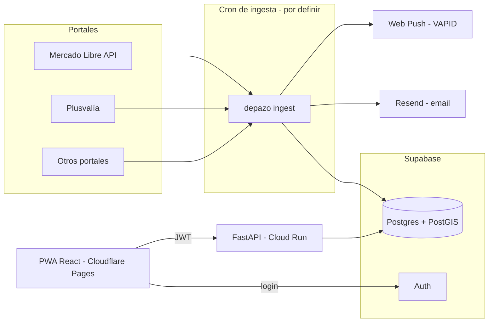
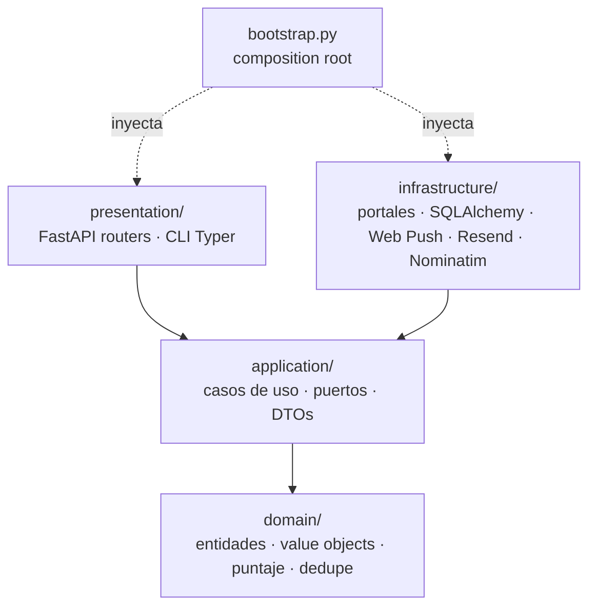

# Arquitectura de depazo

> Estado: **propuesta inicial** (2026-11-13). Cada decisión tiene su ADR en [`docs/adr/`](adr/).

## 1. Contexto

- **Producto:** PWA multiusuario que centraliza anuncios de arriendo de departamentos en **Quito, Ecuador**, los puntúa según las preferencias de cada usuario y notifica oportunidades nuevas.
- **Restricciones:** presupuesto ≈ $0 (free tiers), un solo desarrollador (con Claude), varios portales desde el MVP.
- **Mercado local:** precios en USD; la ubicación se expresa por **sector / barrio / parroquia** (La Carolina, Cumbayá, González Suárez, etc.); los gastos de condominio se llaman **alícuota**.

## 2. Vista general

## 3. Componentes

| Componente | Tecnología | Responsabilidad |
|---|---|---|
| **Frontend (PWA)** | Vite + React + TypeScript, TanStack Router/Query, Tailwind + shadcn/ui, vite-plugin-pwa, MapLibre | Login, configurar búsquedas (dibujar zona en mapa), ver ranking, favoritos, suscripción a push |
| **API** | Python 3.13, FastAPI, Pydantic v2, SQLAlchemy 2 (async), Alembic | CRUD de perfiles de búsqueda, listar matches, registrar suscripciones push |
| **Ingesta (worker)** | Mismo paquete Python, CLI `depazo ingest` | Recolectar → normalizar → deduplicar → guardar → puntuar → notificar |
| **Extensión de navegador** | Chrome MV3, TypeScript, esbuild, Zod (mini) | Captura los anuncios que el usuario ve en Plusvalía y Facebook Marketplace (Properati no hace falta: comparte inventario con iCasas). v1: los guarda en `chrome.storage.local` y los exporta a un JSON `depazo.capture` que se importa con `depazo import`. Cuando exista la API, los enviará a la cuenta del usuario |
| **Base de datos** | Supabase Postgres + PostGIS | Datos de negocio + consultas geoespaciales |
| **Auth** | Supabase Auth (magic link + Google) | Identidad; la API valida el JWT con el JWKS de Supabase |
| **Notificaciones** | Web Push (`pywebpush`, VAPID) + email (Resend) | Alertas inmediatas y resumen diario |
| **Geocoding** | Nominatim (OSM), máximo 1 req/s, con caché en DB | Coordenadas para anuncios sin lat/lon |

## 4. Estilo arquitectónico

### 4.1 Backend: Clean Architecture ([ADR 0008](adr/0008-clean-architecture-backend.md))

Es un **monolito modular** en Python. No hay microservicios: no se justifican con un solo desarrollador y un presupuesto de $0. Internamente sigue la **Clean Architecture**, con la regla de dependencia: el código solo apunta hacia adentro.

- **`domain/`**: no depende de nada. Usa `dataclasses` puras.
- **`application/`**: orquesta los casos de uso y define los **puertos**, que son interfaces (`Protocol`), por ejemplo `ListingSource`, `ListingRepository`, `Notifier`, `Geocoder`, `UnitOfWork`.
- **`infrastructure/`**: implementa esos puertos. Cada portal es un adaptador de `ListingSource`.
- **`presentation/`**: contiene los dos entrypoints, la API y la CLI de ingesta. Solo traduce entre HTTP o CLI y los casos de uso.
- **`bootstrap.py`**: es el único lugar que arma las dependencias concretas.
- **import-linter** verifica en CI que se respete la regla de dependencia.

### 4.2 Frontend: Atomic Design ([ADR 0009](adr/0009-atomic-design-frontend.md))

`atoms → molecules → organisms → templates → pages`. Los niveles de átomos a templates son presentacionales y no hacen fetch. Los datos entran solo en `pages/`, a través de hooks con TanStack Query. Storybook sirve como catálogo.

Las reglas de UX/UI (WCAG, Nielsen, Apple Design y UI UX Pro Max) están en [ux-guidelines.md](ux-guidelines.md), según el [ADR 0010](adr/0010-sistema-ux-ui.md).

## 5. Pipeline de ingesta

Se ejecuta cada hora; cada portal corre como un job aislado. **Dónde corre el cron está pendiente** (ADR 0017): GitHub Actions se descartó y, mientras tanto, se ejecuta a mano con `depazo ingest --save`.

1. **Fetch:** el adaptador del portal pide los listados de Quito (API oficial si existe; si no, HTML con `httpx`; Playwright solo si es imprescindible).
2. **Parse + normalize:** convierte cada anuncio a `RawListing`, validado con Pydantic.
3. **Upsert:** la clave única es `(source, external_id)`. Se detectan anuncios nuevos, cambios de precio y bajas.
4. **Geocode:** solo si faltan coordenadas.
5. **Dedupe:** agrupa en una `Property` canónica los anuncios del mismo inmueble publicados en distintos portales (distancia < 50 m + m² ±5 % + habitaciones iguales + precio ±10 %).
6. **Match:** para cada `SearchProfile` activo, aplica un pre-filtro SQL (precio, habitaciones, `ST_Within` de la zona) y luego calcula el puntaje en Python.
7. **Notify:** si el puntaje supera el umbral del usuario y no se le avisó antes, envía push inmediato y lo encola para el resumen por email.
   - **v1 (implementado):** `--alert-profile` puntúa solo los anuncios nuevos o con precio nuevo de la ejecución y manda **un email de resumen en texto plano** por Resend. No repite avisos porque un anuncio solo es nuevo una vez, y un `Idempotency-Key` evita duplicados si se reintenta. Limitación: si el email falla, los anuncios ya quedaron guardados y ese aviso se pierde; la tabla `matches` con `notified_at` lo resolverá cuando haya multiusuario.
8. **Health check:** si un portal devuelve 0 resultados o falla la validación por encima de un umbral, se marca el run como fallido y se abre un issue en GitHub.

## 6. Modelo de datos (inicial)

- `users`: gestionada por Supabase Auth, más una tabla `profiles` con preferencias de notificación.
- `search_profiles`: `user_id`, presupuesto mín/máx, incluye o no la alícuota, habitaciones, baños, m² mínimos, zona (`geometry(Polygon)`), características obligatorias y deseables, pesos y umbral.
- `listings`: `source`, `external_id`, `url`, precio, alícuota, habitaciones, baños, m², `location geography(Point)`, sector, características (`jsonb`), `first_seen_at`, `last_seen_at`, `status`, `property_id`.
- `properties`: entidad canónica deduplicada.
- `listing_price_history`
- `matches`: `search_profile_id`, `property_id`, `score`, `score_breakdown jsonb`, `notified_at`, `user_state` (nuevo, visto, favorito o descartado).
- `push_subscriptions`, `ingest_runs`, `geocode_cache`.

**No se guardan datos personales de los anunciantes** (teléfonos, nombres, emails): solo el enlace al anuncio original. Así se reduce el riesgo frente a la LOPDP de Ecuador.

## 7. Motor de puntaje

`score(property, profile) -> ScoreResult(total: 0–100, breakdown: dict, passed_hard_filters: bool)`

- **Filtros duros:** precio fuera de rango, zona, características obligatorias. Si alguno falla, la propiedad queda descartada.
- **Criterios blandos ponderados**, cada uno normalizado entre 0 y 1: precio relativo al presupuesto, m², distancia a puntos de interés del usuario, características deseables y antigüedad del anuncio.
- Función pura, determinista y con tests (*property-based* con Hypothesis).

**Implementado (v1, `domain/scoring.py`):**
- Costo mensual = arriendo + alícuota, si el perfil la incluye en el presupuesto. Si el precio es desconocido, el anuncio se descarta.
- Filtros duros: presupuesto máximo y mínimo, habitaciones, baños y m² mínimos y sectores excluidos. Un dato faltante no descarta el anuncio.
- Criterios blandos (pesos por defecto 0,5 / 0,25 / 0,25): **precio** (1 si cuesta hasta el 60 % del presupuesto, 0 si llega al tope), **m²** (0 en el mínimo, 1 al 150 % del mínimo) y **sector preferido** (1 o 0). Un dato desconocido vale 0,5, y un criterio que el perfil no define no cuenta.
- Los sectores se comparan sin tildes, sin mayúsculas y sin espacios repetidos ("González Suárez" = "gonzalez suarez").
- Pendiente: zona dibujada en el mapa (`ST_Within`), características obligatorias y deseables y antigüedad del anuncio.

## 8. Portales candidatos (Quito)

**Verificado el 2026-11-13: ver [portals.md](portals.md) y el [ADR 0016](adr/0016-fuentes-de-datos.md) (propuesta).** Plusvalía, Properati, Vive1 y Mitula bloquean el acceso automatizado; iCasas y Arrienda y Vende lo prohíben en sus términos; OLX Ecuador cerró. Quedan como opciones: la API oficial de Mercado Libre (por confirmar), arriendos.ec (feed RSS, poco volumen) y el enfoque de **organizador personal** (el usuario comparte anuncios desde cualquier portal).

**Política:** la estrategia por portal está en el [ADR 0016](adr/0016-fuentes-de-datos.md).

## 9. Free tiers y riesgos

| Servicio | Uso | Riesgo / mitigación |
|---|---|---|
| ~~GitHub Actions~~ | Descartado (ADR 0017) por problemas de facturación de la cuenta | Verificación local; para el cron, Cloud Run Jobs + Cloud Scheduler o una máquina propia |
| Supabase Free | DB 500 MB + Auth | El proyecto se pausa tras 7 días sin actividad (la ingesta horaria lo mantiene activo). Purgar anuncios dados de baja hace más de 90 días |
| Cloud Run | API (escala a 0) | Requiere tarjeta en GCP aunque no se cobre. Alternativa sin tarjeta: Render (arranque en frío de unos 50 s) |
| Cloudflare Pages | PWA estática | Uso comercial permitido |
| Resend Free | Email | Unos 100 emails/día: usar resumen diario, no un email por cada match |
| Sentry Free | Errores de API, worker y web | — |
| Web Push en iOS | — | Solo funciona con la PWA instalada (iOS 16.4+); el email cubre ese caso |
